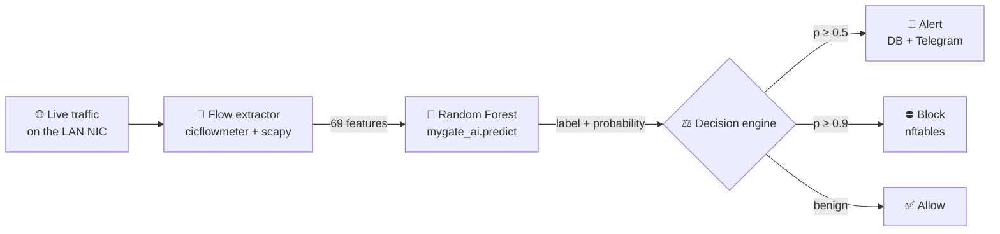
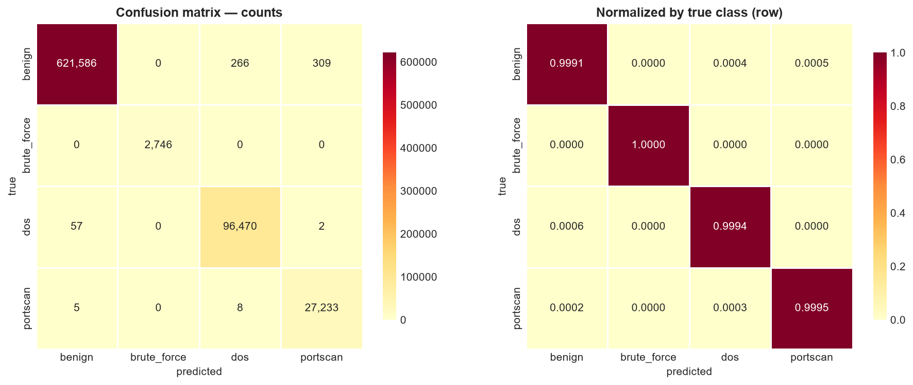
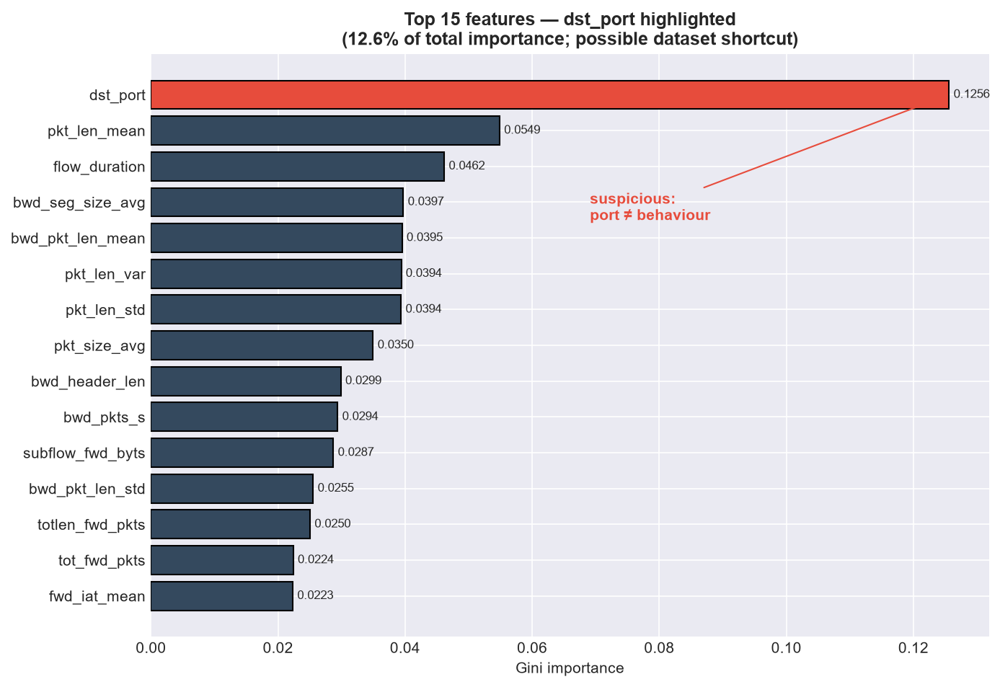
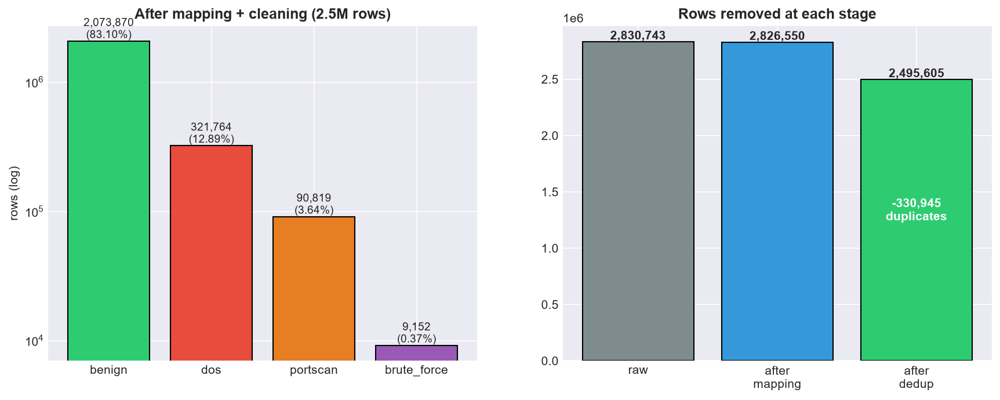
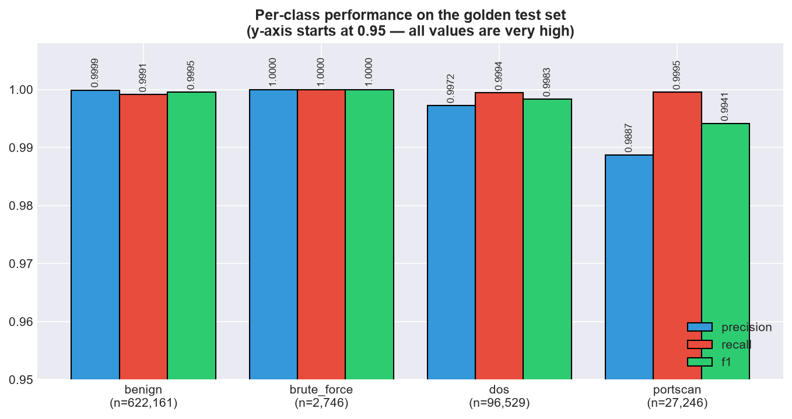
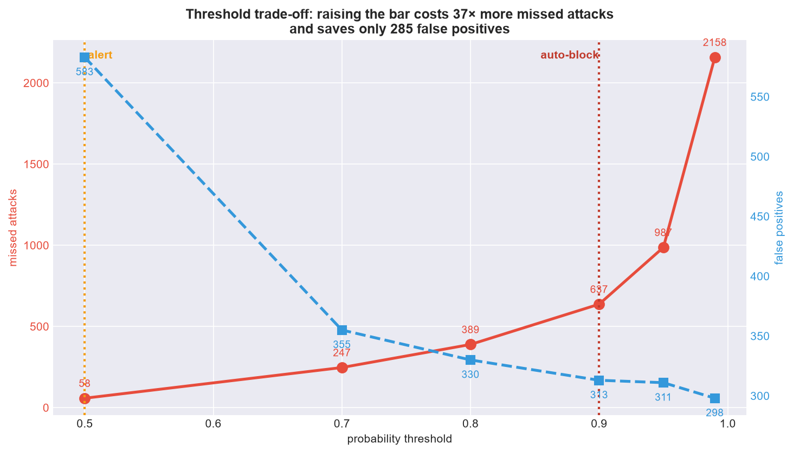
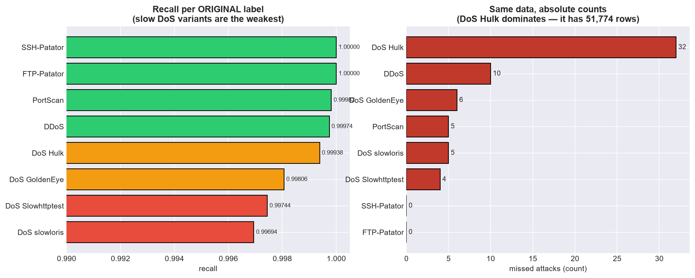

<div align="center">


<a href="#">
  
</a>

<br/>


</div>

---

## 🛡️ What is this?

**MyGate** is a graduation-project network security appliance (IPS) built by a 5-person team:
Suricata + nftables + a FastAPI backend + PostgreSQL. **This repo is its AI layer.**

Every network conversation (a *flow*) is summarised into **69 statistical features** —
durations, packet sizes, inter-arrival times, flag counts — and a Random Forest decides
whether it is normal traffic or one of three attacks:

<div align="center">

| 🟢 `benign` | 🔍 `portscan` | 🔑 `brute_force` | 💥 `dos` |
|:---:|:---:|:---:|:---:|
| normal traffic | nmap-style probing | FTP / SSH password guessing | Hulk, GoldenEye, slowloris, DDoS |

</div>

## ⚙️ How it works



The backend only ever touches one tiny contract:

```python
from mygate_ai import load, predict

load()                      # once, at startup — verifies sha256 + sklearn version
predict(flow_dict)
# {'is_attack': True, 'probability': 0.97, 'attack_type': 'portscan', 'model_version': 'v1'}
```

## 📊 Results (v1, CIC-IDS2017 held-out test set)

Trained on **1,746,923** flows, tested on **748,682** flows it never saw.

<div align="center">

| Class | Precision | Recall | F1 |
|---|:---:|:---:|:---:|
| benign | 0.9999 | 0.9991 | 0.9995 |
| brute_force | 1.0000 | 1.0000 | 1.0000 |
| dos | 0.9972 | 0.9994 | 0.9983 |
| portscan | 0.9887 | 0.9995 | 0.9941 |
| **macro avg** | | **0.9995** | **0.998** |

**Detection rate 99.95 %** · **False-positive rate 0.09 %** at the 0.5 alert threshold

</div>

<p align="center">
  
  
</p>

<details>
<summary><b>📈 More figures</b></summary>
<br/>
<p align="center">
  
  
  
  
</p>
</details>

## 🧪 From the lab — honest status

> [!WARNING]
> The numbers above are **offline** results on CIC-IDS2017. When v1 ran **live** in our lab, a real
> `nmap -sS` scan was classified `benign`. The cause is a **feature-definition mismatch** between the
> Java CICFlowMeter that produced the dataset and the Python `cicflowmeter` used live (packet length,
> header length and SYN/RST counts are computed differently). Full analysis and fix plan:
> **[KNOWN_ISSUES.md](KNOWN_ISSUES.md)**.

## 🗺️ Roadmap

- [x] **v1.0** — Random Forest on CIC-IDS2017, packaged as a wheel with a frozen contract
- [x] Real-time flow extractor (seconds instead of a 240 s timeout) + alert de-duplication
- [ ] Java-compatible feature layer so live flows match the training data
- [ ] Live evaluation from a Kali attacker VM: portscan · brute force · DoS
- [ ] **v1.1** — retrain with lab traffic only if live evaluation still shows gaps

## 📁 Project structure

```
mygate_ai/   📦 shipped package — inference only (load · predict · schema · features)
src/         🔧 training pipeline — loaders · clean · train · evaluate · export
tests/       ✅ contract + schema tests
notebooks/   📓 EDA and model comparison (RF, XGBoost, LightGBM, LogReg, NN)
reports/     📊 evaluation figures
```

<details>
<summary><b>🛠️ Run it yourself</b></summary>

```bash
python -m venv .venv && source .venv/bin/activate
pip install -r requirements-dev.txt
# put the CIC-IDS2017 CSVs in data/
python -m src.train              # full training  → mygate_ai/models/v1/
python -m src.evaluate --write   # re-evaluate an existing model
python -m pytest -v
python -m build --wheel          # → dist/mygate_ai-*.whl
```

Arabic developer guide: [docs/README_AR.md](docs/README_AR.md) · Backend integration: [INTEGRATION.md](INTEGRATION.md)
</details>

---

<div align="center">

Built by **[Shady Ashraf](https://github.com/shadyy-ashraff)** — AI layer of the MyGate graduation project · Benha University


</div>
